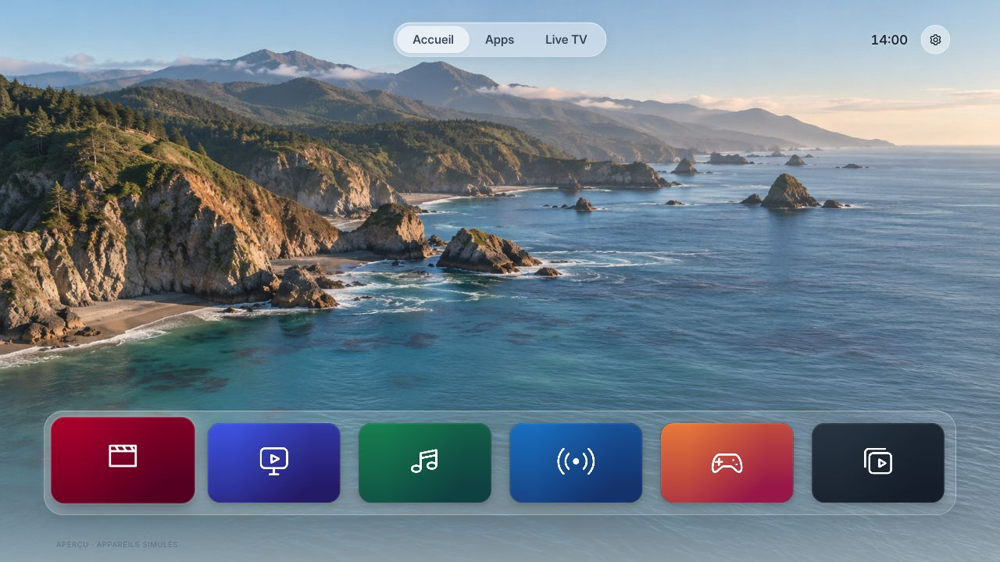
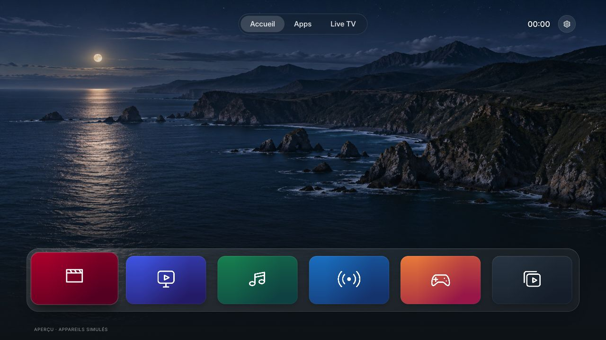

<p align="center"></p>

<h1 align="center">Frame Home</h1>
<p align="center"><strong>Apple TV vibes. Samsung hardware.</strong><br>L’esprit Apple TV, sur votre Samsung The Frame.</p>
<p align="center">Gratuit · Code MIT · Local · Sans publicité dans l’accueil · Installation réversible</p>



<details>
<summary>Voir le mode sombre</summary>



</details>

Un accueil inspiré de tvOS : un beau paysage, six apps, une sélection fluide et les bons réglages à portée de télécommande. Frame Home est une application Tizen autonome ; le système Samsung et ses applications restent en place.

**Version publique expérimentale 0.8.1.** Le prototype dont elle est issue a été utilisé sur une **The Frame LS03B (2022), Tizen 6.5, firmware 1720**. Les adaptations portables de cette version sont testées dans le navigateur et par les tests automatisés ; leur validation matérielle reste à compléter. [Compatibilité et limites](docs/COMPATIBILITY.md).

Les captures utilisent des **apps de démonstration illustratives**, des pictogrammes originaux et des fonds créés pour ce projet. Sur une TV, le catalogue et les icônes proviennent de ses applications réellement installées. Aucune liste d’apps, photo de salon ou donnée de compte d’une installation privée n’est publiée.

## Ce que fait Frame Home

- **Accueil façon Apple TV** : dock translucide, vrais coins arrondis, focus agrandi et espace laissé au fond d’écran.
- **Six favoris** : appui long sur OK pour épingler, retirer ou déplacer ; toutes les apps restent dans Apps.
- **Clair / sombre automatique** : horaires locaux par défaut ; lever/coucher du soleil si vous configurez une ville, sans GPS ni service distant.
- **Fonds locaux** : Coast jour/nuit et Ardoise inclus ; import de vos propres images et cartes, avec miniatures et suppression des métadonnées.
- **Appareils HDMI** : rangée masquée tant qu’aucune connexion n’est signalée ; nom et icône personnalisables. La connexion n’est pas une preuve d’allumage d’une console.
- **Live TV** : profil d’exemple Samsung TV+ France et accès aux fournisseurs installés. Les numéros et droits dépendent du pays et du service.
- **Mode Art préservé** : le bouton Power garde le comportement natif ; la reprise de la dernière app se règle dans Samsung.
- **Un fonctionnement local** : aucun compte Frame Home, abonnement, serveur Mac nécessaire après installation ou télémétrie intégrée.

Le bouton **Retour** remonte dans l’app puis reste sur son accueil. Le bouton **Home physique reste géré par Samsung**. Frame Home n’installe aucun remappage privé, service de relance, root ou modification de firmware.

## Essayer sur ordinateur

Python 3.10+ suffit. Depuis un terminal :

```sh
git clone https://github.com/Liftof/frame-home.git
cd frame-home
python3 tools/preview.py
```

Ouvrez [127.0.0.1:8766](http://127.0.0.1:8766/). Flèches pour naviguer, Entrée pour OK, Entrée maintenue pour les options, Échap pour Retour. Le clic droit ouvre aussi les options. La démo simule les ouvertures et ne contrôle aucune TV.

## Installer sur une The Frame

Le parcours complet, avec dépannage du mode développeur et restauration :

- **[Guide français : du mode développeur à l’installation](docs/INSTALL.fr.md)**
- **[English installation guide](docs/INSTALL.md)**

Le principe : Apps → Paramètres des applications → pavé numérique → `12345` → Developer Mode On → adresse locale de votre ordinateur → redémarrage. Puis créez **vos propres certificats Samsung**, signez le paquet et installez-le avec le SDK. Aucun certificat ni accès à une autre TV n’est fourni.

```sh
python3 tools/build.py --public
```

Cette commande produit un WGT **non signé**, sans réglages ni médias privés. La signature et l’installation sont des étapes distinctes documentées dans le guide. Un paquet signé pour un autre utilisateur ou téléviseur ne suffit pas.

## Personnaliser

[Ville, fonds personnels, logos locaux, favoris et chaînes](docs/CUSTOMIZATION.md).

Les réglages de votre installation restent dans `local/`, les images importées dans `app/assets/local/` : ces deux dossiers sont exclus de Git. L’import ne télécharge rien et ne publie rien. Les fonds Apple et logos propriétaires ne sont pas distribués avec le dépôt ; vous pouvez importer localement les images que vous êtes autorisé à utiliser.

## Tests et architecture

```sh
node --test tests/*.test.cjs
python3 -m unittest discover -s tests -p 'test_*.py'
python3 tools/check_public.py
python3 tools/build.py --public
```

Node 18+ pour les tests. Aucun framework ou paquet JavaScript à installer pour exécuter l’app. Pillow est facultatif pour importer et optimiser des images ; voir `requirements-tools.txt`.

Le cache validé affiche le dernier catalogue local au démarrage puis le rafraîchit. Les tuiles sont réutilisées lors de la navigation et de l’épinglage. Les icônes carrées sont encadrées une seule fois à leur chargement, sans lecture/export de leurs pixels. Les fonds attendent le décodage avant remplacement ; horloge et surveillance HDMI se suspendent quand l’app est masquée. [Architecture](docs/ARCHITECTURE.md).

Les tests ne mesurent pas les FPS ni la RAM totale d’un téléviseur. Aucun pourcentage de gain sur Smart Hub n’est annoncé.

## Licence et indépendance

Code et créations originales : [MIT](LICENSE), réutilisables gratuitement, y compris pour modifier et redistribuer le projet. Inter conserve sa licence OFL et SunCalc sa licence BSD. [Assets, sources et notices](docs/ASSETS.md).

Merci à [Arn0 Launcher](https://github.com/NelsonEU/arn0-tv) pour les exemples d’API Tizen publiques, à [Reframe](https://github.com/iampiny/reframe) et [CleanFrame](https://github.com/nthnclrk/CleanFrame) pour leurs recherches sur cette famille de projets. Leurs méthodes privées de remappage ne sont pas intégrées.

Projet indépendant, sans affiliation ni approbation d’Apple ou de Samsung. Apple, Apple TV et tvOS sont des marques d’Apple Inc. Samsung et The Frame sont des marques de Samsung. Les applications et chaînes restent celles de leurs éditeurs respectifs.
